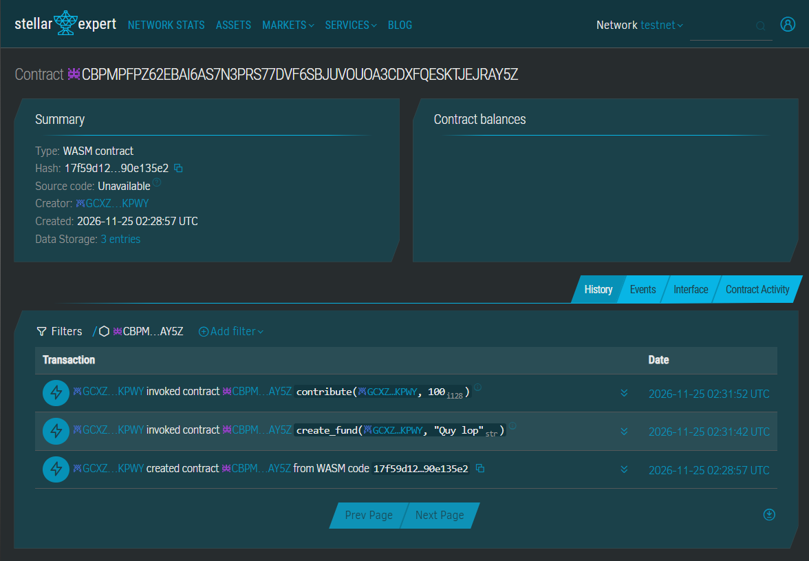

# ClassFund

## Project Title

ClassFund — Class Contribution Ledger on Stellar

## Project Description

ClassFund is a student smart contract project for the Stellar × VKU program. Each deployed contract manages one class fund, including its name, creator, total declared contributions, and contribution total for each address. Users authorize their own contributions, and anyone can read the recorded totals. This demo records numbers only: it does not transfer tokens, hold funds, or verify actual payments.

## Project Vision

Make class contribution records easier to inspect while learning how blockchain storage and authorization work. ClassFund provides a small foundation for future group budget tools, including the TourPay travel fund concept.

## Key Features

| Function | Behavior and access |
| --- | --- |
| `create_fund` | Creates the fund once with a nonempty name and an initial total of zero. Requires the creator's authorization. |
| `contribute` | Adds a positive integer amount to the fund total and the contributor's total. Requires that contributor's authorization. Repeated contributions accumulate. |
| `get_fund` | Returns the fund name, creator, and total contributions. Anyone can call it without authorization. |
| `get_contribution` | Returns an address's accumulated contributions, or zero if it has not contributed. Anyone can call it without authorization. |

The fund must exist before contributions or reads. Invalid amounts, duplicate initialization, empty names, and arithmetic overflow return contract errors. Missing authorization is rejected by Soroban. Data is stored in persistent storage; this demo does not automatically extend its TTL.

## Usage Instructions

Run all commands from the project root in PowerShell or Windows Terminal. Install Rust with the `wasm32v1-none` target and Stellar CLI first. The implementation is in `contracts/hello-world/src/lib.rs`; the crate name remains `hello-world`.

**1. Build the contract**

```powershell
stellar contract build
```

The WASM output is `target/wasm32v1-none/release/hello_world.wasm`.

**2. Prepare a Testnet identity**

If you do not already have an identity named `student`, create and fund it with test XLM:

```powershell
stellar keys generate student --network testnet --fund
```

Display its public address:

```powershell
stellar keys address student
```

Use Testnet only and keep the secret key private. In the commands below, Stellar CLI resolves the address alias `student` to this identity's public address.

**3. Deploy a fresh contract**

```powershell
stellar contract deploy --wasm target/wasm32v1-none/release/hello_world.wasm --source-account student --network testnet --alias my-contract
```

Save the returned Contract ID. This command deploys a fresh instance with its own state; its ID may differ from the existing deployment documented below. If `my-contract` already points to the deployment you want to use, skip this step.

**4. Call all four functions**

For a fresh, uninitialized instance, create the fund:

```powershell
stellar contract invoke --id my-contract --source-account student --network testnet -- create_fund --creator student --name "Quy lop"
```

`create_fund` succeeds only once per contract instance. Skip it if the fund already exists.

Record a contribution of 100:

```powershell
stellar contract invoke --id my-contract --source-account student --network testnet -- contribute --contributor student --amount 100
```

Read the fund:

```powershell
stellar contract invoke --id my-contract --source-account student --network testnet -- get_fund
```

Read the student's contribution total:

```powershell
stellar contract invoke --id my-contract --source-account student --network testnet -- get_contribution --contributor student
```

For a fresh fund after exactly one contribution of 100, the expected results are:

- `get_fund`: `name` is `Quy lop`, `creator` is the student's public address, and `total_contributions` is 100.
- `get_contribution`: 100.

Running `contribute` again adds another contribution; it does not replace the previous total. The documented deployment has already been initialized and received a contribution of 100. A `Simulation identified as read-only` message for either read function is normal.

**Verification status:** The contract build succeeded during development. Deployment, fund creation, and a contribution of 100 were confirmed in the project walkthrough and explorer screenshot. The read results listed above are expected outputs. ClassFund unit tests have not yet been implemented or run.

## Future Scope

- Add unit tests for valid operations, invalid inputs, authorization, and overflow.
- Record individual contribution events and support easier history lookup.
- Add TTL maintenance for long-term use.
- Explore spending records and settlement rules for group budgets.
- Explore actual token transfers as a separate extension.

## Technology Stack

- Rust with Soroban SDK 29.0.1, as resolved in `Cargo.lock`.
- Stellar CLI 30.0.1.
- Stellar Testnet.
- WebAssembly (`wasm32v1-none`).

## Contract Detail

Network: Stellar Testnet

Contract ID: `CBPMPFPZ62EBAI6AS7N3PRS77DVF6SBJUVOUOA3CDXFQESKTJEJRAY5Z`

Deployer: `GCXZ5JLFTSFJ624JJFAIMCIYXX3KDYHVPK6D44XUDZWLWU5VOW6CKPWY`

Explorer: [View ClassFund on Stellar Expert](https://stellar.expert/explorer/testnet/contract/CBPMPFPZ62EBAI6AS7N3PRS77DVF6SBJUVOUOA3CDXFQESKTJEJRAY5Z)


